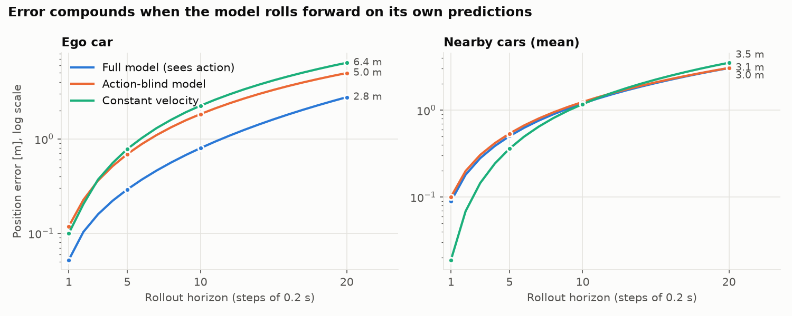
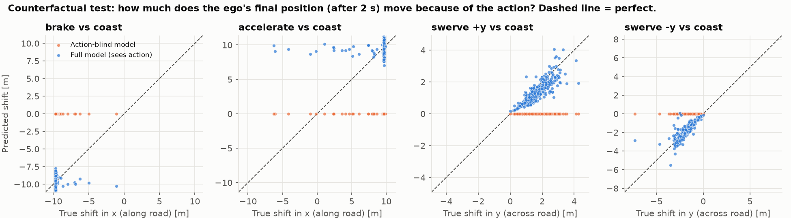
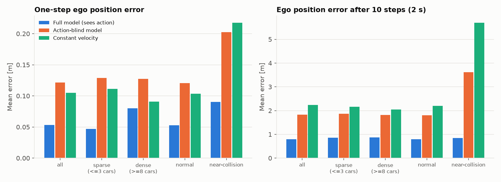

# tiny_wm: a toy driving world model in highway-env

An MLP learns a one-step dynamics model (`state + action -> change in state`) from
highway-env, then gets tested on compounding rollout error, counterfactual action
branches, and traffic/risk slices. The state is low-dimensional (positions and
velocities, not pixels), so treat this as a toy.

## Run it

```bash
uv venv -p 3.12 .venv && uv pip install -p .venv/bin/python -r requirements.txt

.venv/bin/python -m wm.collect                 # ~100k transitions, ~1 min on 16 cores
.venv/bin/python -m wm.train                   # full + action-blind models, ~3 min on CPU
.venv/bin/python -m wm.evaluate                # writes results/ (plots + results.json)

# Second experiment: noise-free data-collection driver
.venv/bin/python -m wm.collect --clean --out data/episodes_clean.pkl
.venv/bin/python -m wm.train --data data/episodes_clean.pkl --models models_clean
.venv/bin/python -m wm.evaluate --data data/episodes_clean.pkl --models models_clean --out results_clean --clean
```

| File | What it does |
|---|---|
| [wm/common.py](wm/common.py) | env config, the data-collection driver, state encoding, the MLP |
| [wm/collect.py](wm/collect.py) | step 1: log every vehicle's state + the ego action, in parallel |
| [wm/dataset.py](wm/dataset.py) | one-step transitions, train/val/test split by episode, slice tags |
| [wm/train.py](wm/train.py) | step 2: train the full model and the action-blind baseline |
| [wm/evaluate.py](wm/evaluate.py) | steps 3–5: compounding error, counterfactuals, slices |

## Design choices that matter

- **Continuous actions (acceleration, steering), not the default discrete meta-actions.**
  `DiscreteMetaAction` ("change lane", "go faster") drives a hidden controller with its
  own target lane and speed. That controller state isn't in the observation, so the next
  state wouldn't be predictable from (state, action). With continuous control, the action
  maps directly onto the ego car's bicycle model.
- **State = ego + 8 nearest cars within 100 m**, positions relative to the ego. The
  ego's absolute x is dropped because the road is uniform along x. The model predicts
  the *change* over one 0.2 s step.
- **Fixed identities across a rollout.** The 8 cars chosen at the start are the ones
  tracked and scored for all 20 steps. Each step, slots are re-sorted by distance so
  the input looks like the training data.
- **Data-collection driver**: a lane-keeping, car-following controller that picks
  random target lanes and speeds, plus action noise and short random bursts (hard
  brake, hard throttle, sharp steering) so the data covers more than cruising.
  Traffic density is randomized per episode.
- **Three models**: `full` (sees the action), `blind` (identical but never sees the
  action), and `cv` (constant velocity, no learning). The `cv` baseline is a free sanity
  check: a learned model should beat it.
- Train/val/test are split **by episode**. Counterfactual start states come from fresh
  seeds that never appear in training.

## Results

Main run (noisy driver, 103k transitions, 1,088 episodes). Numbers are on held-out
test episodes.

### 3. Compounding error



| Ego position error [m] | 1 step | 5 | 10 | 20 (4 s) |
|---|---|---|---|---|
| full | 0.05 | 0.29 | 0.80 | 2.76 |
| blind | 0.12 | 0.69 | 1.83 | 4.97 |
| constant velocity | 0.10 | 0.78 | 2.24 | 6.38 |

Error grows faster than linearly: 0.05 m after one step becomes 2.8 m after 20.
That's the expected drift.

Most of what the model knows is about the ego car. **For the surrounding cars it
does not beat constant velocity**: it's worse at one step (0.09 m vs 0.02 m) and only
about even by step 10 (1.19 vs 1.17 m). Other cars run IDM/MOBIL controllers with
hidden state (each car's own target speed, when it decides to change lanes), and they
react to cars outside the 8 we track. Much of their motion can't be predicted from this
state, and the MLP adds noise where constant velocity is already close to right.

### 4. Action conditioning and the counterfactual test

From 400 unseen start states, the real simulator was copied with `copy.deepcopy`
and run 2 s (10 steps) under five scripted actions: coast, full brake, full throttle,
and a jink (steer one way for 3 steps, back for 3) in each direction. The "effect" of
an action is where the ego ends up minus where it ends up when coasting.



| | brake | accelerate | swerve +y | swerve −y |
|---|---|---|---|---|
| true effect on ego position | 9.6 m | 9.4 m | 2.0 m | 2.1 m |
| full: share of effect captured | 93% | 89% | 60% | 54% |
| full: predicted direction correct | 100% | 99% | 100% | 100% |
| blind: share of effect captured | 0% | 0% | 0% | 0% |

Effect on **other** cars (followers braking when the ego brakes, and so on):
57–115 neighbors moved more than 0.5 m because of the ego's choice. The full model
captured **none of it**: its share captured was between −8% and +1%. It learned how the
ego responds to its own action, but not how other cars respond to the ego.

**The hypothesis did not hold as stated.** The blind model was clearly worse on
one-step error, not nearly as good:

| One-step, test set | full | blind | blind / full |
|---|---|---|---|
| aggregate normalized MSE (= training loss, all dims) | 0.42 | 0.56 | 1.3× |
| neighbor position error | 0.082 m | 0.143 m | 1.7× |
| ego position error | 0.053 m | 0.122 m | 2.3× |
| ego velocity error | 0.089 m/s | 0.544 m/s | 6.1× |

My guess was that the noisy driver made actions impossible to guess from the state.
So I reran everything with a **noise-free driver** (`--clean`), where the action is
almost a deterministic function of the state:

| One-step, clean driver | full | blind | blind / full |
|---|---|---|---|
| aggregate normalized MSE | 0.42 | 0.52 | 1.2× |
| ego position error | 0.042 m | 0.072 m | 1.7× |
| ego velocity error | 0.054 m/s | 0.215 m/s | 4.0× |

The gap shrinks, as expected, but doesn't close. Even the "clean" driver re-picks its
target lane and speed at random, and those targets are hidden. The counterfactual
result was unchanged: the full model captured 41–93% of the effect, the blind model 0%.

A softer version of the hypothesis does hold:
- **The aggregate one-step metric understates the difference.** The blind model is only
  1.2–1.3× worse on the training loss, but it captures 0% vs ~90% of a braking or
  throttle effect. Most output dimensions describe other cars, which the ego's action
  barely moves in one step, so they dilute the gap.
- **One-step error ranks models wrongly.** On clean data, constant velocity has the
  *lowest* one-step ego position error (0.029 m vs 0.042 m for the full model). At
  10 steps it's 3× worse (1.67 m vs 0.53 m). By one-step error alone, you'd pick the
  wrong model.

### 5. Slices



- **Dense vs sparse traffic** (≥8 vs ≤3 cars within 50 m): the full model's one-step
  error is about 2× worse in dense traffic (normalized MSE 0.65 vs 0.31; ego position
  0.080 vs 0.047 m). Dense traffic is only 6% of test steps. By step 10 the gap is
  mostly gone for the ego (0.88 vs 0.86 m), because error from the ego's own motion
  takes over.
- **Near-collision moments** (time-to-collision < 1.5 s, bumper gap < 3 m, or a crash
  within 2 s) are 1.3% of test steps. The full model's one-step normalized MSE there is
  **2.9× the normal-traffic value** (1.19 vs 0.41). The blind and constant-velocity
  baselines fall apart there (3.6 m and 5.7 m at 10 steps vs 0.85 m), because those
  moments are mostly hard braking.
- **Counterfactual branches that end in a crash**: when the scripted action drives the
  ego into another car, the full model's final position error goes from ~1 m to
  **5.5–9.4 m**. The model has never learned that hitting something stops you. In the
  "accelerate" panel above, these are the points predicted at +10 m that really moved
  much less. This is the long-tail problem in miniature. Crashes are rare in the data
  (70 of 1,088 episodes), so the loss barely sees them, and the model is most wrong
  exactly where it matters.
- The top 1% of training samples by error carry 38% of the validation loss (mostly
  neighbor lane-change onsets). The average hides this.

## Caveats

- One training seed, no error bars. The near-collision *rollout* slice is small
  (38 windows; 22 in the clean run), so treat its multi-step numbers as rough. The
  one-step near-collision slice (259 steps) is more solid.
- Both models start overfitting after ~15 epochs (validation loss rises). The best
  validation checkpoint is kept.
- `n_close` (cars within 50 m) measures local density. It doesn't measure density
  over the whole episode.
- The counterfactual swerve (3 steps at 0.3 steering) is near the edge of the training
  data. That probably explains part of why swerves are captured less well (40–60%) than
  braking (93%).

## Ideas for next steps

- Train on multi-step rollout loss (unroll 5–10 steps in training) and see how much
  of the compounding error that removes.
- Replace the flat MLP with a per-vehicle model that shares weights across cars
  (a small graph or attention network). This should help with the neighbor predictions
  and with neighbors reacting to the ego.
- Oversample near-collision and crash transitions, then check whether the crash-branch
  error falls without hurting the normal slice.
- Ensembles: does disagreement between ensemble members flag the crash branches
  ahead of time?
